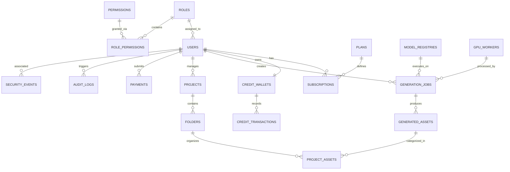

# Database Architecture & Relational Schema Design

**Document Version:** 1.0.0  
**Status:** Approved for Architecture & Planning (Phase 1)  
**Author:** Principal Database Architect & SaaS Backend Lead  
**Target Engine:** MySQL 8.0+ (InnoDB Storage Engine, strict SQL mode, UTF8MB4 charset)  

---

## 1. Schema Design Principles & Concurrency Control

### 1.1 Core Principles
1. **Third Normal Form (3NF) Compliance:** Strictly normalized entities eliminating data anomalies and redundant storage.
2. **Double-Entry Style Credit Ledger:** The `credit_wallets` balance is strictly backed by immutable, auditable rows in `credit_transactions`.
3. **Idempotency & Race Protection:** Credit reservations and settlements use unique cryptographic idempotency keys (`idempotency_key`) and row-level locking (`SELECT ... FOR UPDATE`) inside atomic database transactions (`START TRANSACTION ... COMMIT`).
4. **Soft Deletions & Audit Retention:** User assets and project folders utilize `deleted_at` timestamps for safe soft deletion, preserving relational integrity for billing audits.
5. **High-Performance Partitioning & Indexing:** Large-scale append-only tables (`generation_jobs`, `credit_transactions`, `audit_logs`) feature compound indexes and are architected for monthly range partitioning.

---

## 2. Entity-Relationship Diagram (ERD)



---

## 3. Production MySQL DDL Schema Proposal

```sql
-- =============================================================================
-- DATABASE INITIALIZATION & CHARACTER ENCODING
-- =============================================================================
CREATE DATABASE IF NOT EXISTS `antigravity_saas`
  DEFAULT CHARACTER SET utf8mb4
  DEFAULT COLLATE utf8mb4_unicode_ci;

USE `antigravity_saas`;

-- Disable foreign key checks during schema definition
SET FOREIGN_KEY_CHECKS = 0;

-- =============================================================================
-- 1. ROLES & PERMISSIONS (RBAC)
-- =============================================================================
CREATE TABLE `roles` (
  `id` INT UNSIGNED AUTO_INCREMENT PRIMARY KEY,
  `slug` VARCHAR(50) NOT NULL UNIQUE,
  `name` VARCHAR(100) NOT NULL,
  `description` VARCHAR(255) NULL,
  `created_at` TIMESTAMP DEFAULT CURRENT_TIMESTAMP,
  `updated_at` TIMESTAMP DEFAULT CURRENT_TIMESTAMP ON UPDATE CURRENT_TIMESTAMP
) ENGINE=InnoDB;

CREATE TABLE `permissions` (
  `id` INT UNSIGNED AUTO_INCREMENT PRIMARY KEY,
  `slug` VARCHAR(100) NOT NULL UNIQUE,
  `name` VARCHAR(100) NOT NULL,
  `module` VARCHAR(50) NOT NULL,
  `created_at` TIMESTAMP DEFAULT CURRENT_TIMESTAMP
) ENGINE=InnoDB;

CREATE TABLE `role_permissions` (
  `role_id` INT UNSIGNED NOT NULL,
  `permission_id` INT UNSIGNED NOT NULL,
  PRIMARY KEY (`role_id`, `permission_id`),
  FOREIGN KEY (`role_id`) REFERENCES `roles` (`id`) ON DELETE CASCADE,
  FOREIGN KEY (`permission_id`) REFERENCES `permissions` (`id`) ON DELETE CASCADE
) ENGINE=InnoDB;

-- =============================================================================
-- 2. USERS & AUTHENTICATION
-- =============================================================================
CREATE TABLE `users` (
  `id` BIGINT UNSIGNED AUTO_INCREMENT PRIMARY KEY,
  `uuid` CHAR(36) NOT NULL UNIQUE,
  `email` VARCHAR(255) NOT NULL UNIQUE,
  `password_hash` VARCHAR(255) NOT NULL,
  `full_name` VARCHAR(150) NOT NULL,
  `role_id` INT UNSIGNED NOT NULL DEFAULT 1,
  `status` ENUM('ACTIVE', 'SUSPENDED', 'PENDING_VERIFICATION') NOT NULL DEFAULT 'PENDING_VERIFICATION',
  `avatar_url` VARCHAR(512) NULL,
  `stripe_customer_id` VARCHAR(100) NULL UNIQUE,
  `two_factor_secret` VARCHAR(255) NULL,
  `is_two_factor_enabled` BOOLEAN NOT NULL DEFAULT FALSE,
  `created_at` TIMESTAMP DEFAULT CURRENT_TIMESTAMP,
  `updated_at` TIMESTAMP DEFAULT CURRENT_TIMESTAMP ON UPDATE CURRENT_TIMESTAMP,
  `deleted_at` TIMESTAMP NULL DEFAULT NULL,
  FOREIGN KEY (`role_id`) REFERENCES `roles` (`id`),
  INDEX `idx_users_email` (`email`),
  INDEX `idx_users_uuid` (`uuid`),
  INDEX `idx_users_stripe` (`stripe_customer_id`)
) ENGINE=InnoDB;

-- =============================================================================
-- 3. SUBSCRIPTION PLANS & BILLING
-- =============================================================================
CREATE TABLE `plans` (
  `id` INT UNSIGNED AUTO_INCREMENT PRIMARY KEY,
  `slug` VARCHAR(50) NOT NULL UNIQUE,
  `name` VARCHAR(100) NOT NULL,
  `price_cents` INT UNSIGNED NOT NULL,
  `billing_interval` ENUM('MONTHLY', 'YEARLY') NOT NULL DEFAULT 'MONTHLY',
  `monthly_credits` INT UNSIGNED NOT NULL,
  `max_concurrent_jobs` TINYINT UNSIGNED NOT NULL DEFAULT 1,
  `priority_level` TINYINT UNSIGNED NOT NULL DEFAULT 1, -- 1=standard, 5=pro, 10=enterprise
  `features_json` JSON NOT NULL,
  `is_active` BOOLEAN NOT NULL DEFAULT TRUE,
  `stripe_price_id` VARCHAR(100) NULL UNIQUE,
  `created_at` TIMESTAMP DEFAULT CURRENT_TIMESTAMP,
  `updated_at` TIMESTAMP DEFAULT CURRENT_TIMESTAMP ON UPDATE CURRENT_TIMESTAMP
) ENGINE=InnoDB;

CREATE TABLE `subscriptions` (
  `id` BIGINT UNSIGNED AUTO_INCREMENT PRIMARY KEY,
  `user_id` BIGINT UNSIGNED NOT NULL,
  `plan_id` INT UNSIGNED NOT NULL,
  `stripe_subscription_id` VARCHAR(100) NOT NULL UNIQUE,
  `status` ENUM('ACTIVE', 'TRIALING', 'PAST_DUE', 'CANCELED', 'INCOMPLETE') NOT NULL DEFAULT 'INCOMPLETE',
  `current_period_start` TIMESTAMP NOT NULL,
  `current_period_end` TIMESTAMP NOT NULL,
  `cancel_at_period_end` BOOLEAN NOT NULL DEFAULT FALSE,
  `canceled_at` TIMESTAMP NULL DEFAULT NULL,
  `created_at` TIMESTAMP DEFAULT CURRENT_TIMESTAMP,
  `updated_at` TIMESTAMP DEFAULT CURRENT_TIMESTAMP ON UPDATE CURRENT_TIMESTAMP,
  FOREIGN KEY (`user_id`) REFERENCES `users` (`id`) ON DELETE CASCADE,
  FOREIGN KEY (`plan_id`) REFERENCES `plans` (`id`),
  INDEX `idx_subs_user_status` (`user_id`, `status`)
) ENGINE=InnoDB;

CREATE TABLE `payments` (
  `id` BIGINT UNSIGNED AUTO_INCREMENT PRIMARY KEY,
  `uuid` CHAR(36) NOT NULL UNIQUE,
  `user_id` BIGINT UNSIGNED NOT NULL,
  `stripe_charge_id` VARCHAR(100) NOT NULL UNIQUE,
  `amount_cents` INT UNSIGNED NOT NULL,
  `currency` CHAR(3) NOT NULL DEFAULT 'USD',
  `payment_type` ENUM('SUBSCRIPTION', 'TOP_UP') NOT NULL,
  `status` ENUM('SUCCEEDED', 'PENDING', 'FAILED', 'REFUNDED') NOT NULL,
  `receipt_url` VARCHAR(512) NULL,
  `metadata_json` JSON NULL,
  `created_at` TIMESTAMP DEFAULT CURRENT_TIMESTAMP,
  FOREIGN KEY (`user_id`) REFERENCES `users` (`id`),
  INDEX `idx_payments_user` (`user_id`),
  INDEX `idx_payments_status` (`status`)
) ENGINE=InnoDB;

-- =============================================================================
-- 4. CREDIT WALLET & TRANSACTIONAL LEDGER
-- =============================================================================
CREATE TABLE `credit_wallets` (
  `id` BIGINT UNSIGNED AUTO_INCREMENT PRIMARY KEY,
  `user_id` BIGINT UNSIGNED NOT NULL UNIQUE,
  `balance` INT NOT NULL DEFAULT 0,
  `reserved_credits` INT NOT NULL DEFAULT 0,
  `lifetime_granted` BIGINT UNSIGNED NOT NULL DEFAULT 0,
  `lifetime_spent` BIGINT UNSIGNED NOT NULL DEFAULT 0,
  `version` BIGINT UNSIGNED NOT NULL DEFAULT 0, -- Optimistic locking
  `updated_at` TIMESTAMP DEFAULT CURRENT_TIMESTAMP ON UPDATE CURRENT_TIMESTAMP,
  FOREIGN KEY (`user_id`) REFERENCES `users` (`id`) ON DELETE CASCADE,
  CONSTRAINT `chk_balance_non_negative` CHECK (`balance` >= 0),
  CONSTRAINT `chk_reserved_non_negative` CHECK (`reserved_credits` >= 0)
) ENGINE=InnoDB;

CREATE TABLE `credit_transactions` (
  `id` BIGINT UNSIGNED AUTO_INCREMENT PRIMARY KEY,
  `wallet_id` BIGINT UNSIGNED NOT NULL,
  `idempotency_key` VARCHAR(128) NOT NULL UNIQUE,
  `job_id` BIGINT UNSIGNED NULL,
  `payment_id` BIGINT UNSIGNED NULL,
  `type` ENUM('MONTHLY_GRANT', 'TOP_UP_PURCHASE', 'RESERVE', 'SETTLE', 'REFUND', 'ADMIN_ADJUSTMENT') NOT NULL,
  `amount` INT NOT NULL, -- Positive for credits added, negative for spent/settled
  `balance_after` INT NOT NULL,
  `reserved_after` INT NOT NULL,
  `description` VARCHAR(255) NOT NULL,
  `created_at` TIMESTAMP DEFAULT CURRENT_TIMESTAMP,
  FOREIGN KEY (`wallet_id`) REFERENCES `credit_wallets` (`id`),
  INDEX `idx_tx_wallet_created` (`wallet_id`, `created_at`),
  INDEX `idx_tx_idempotency` (`idempotency_key`)
) ENGINE=InnoDB;

-- =============================================================================
-- 5. MODEL REGISTRIES & HARDWARE WORKERS
-- =============================================================================
CREATE TABLE `model_registries` (
  `id` INT UNSIGNED AUTO_INCREMENT PRIMARY KEY,
  `model_identifier` VARCHAR(100) NOT NULL UNIQUE, -- e.g. 'flux-2-klein-4b'
  `display_name` VARCHAR(150) NOT NULL,
  `model_family` ENUM('FLUX', 'Z_IMAGE', 'WAN_VIDEO', 'LTX_VIDEO') NOT NULL,
  `media_type` ENUM('IMAGE', 'VIDEO') NOT NULL,
  `weights_path` VARCHAR(255) NOT NULL,
  `required_vram_gb` DECIMAL(4,1) NOT NULL,
  `default_credit_cost` INT UNSIGNED NOT NULL,
  `is_active` BOOLEAN NOT NULL DEFAULT TRUE,
  `created_at` TIMESTAMP DEFAULT CURRENT_TIMESTAMP,
  `updated_at` TIMESTAMP DEFAULT CURRENT_TIMESTAMP ON UPDATE CURRENT_TIMESTAMP
) ENGINE=InnoDB;

CREATE TABLE `gpu_workers` (
  `id` INT UNSIGNED AUTO_INCREMENT PRIMARY KEY,
  `worker_uuid` CHAR(36) NOT NULL UNIQUE,
  `hostname` VARCHAR(150) NOT NULL,
  `ip_address` VARCHAR(45) NOT NULL,
  `pool_type` ENUM('IMAGE_POOL', 'VIDEO_POOL') NOT NULL,
  `gpu_model` VARCHAR(100) NOT NULL, -- e.g. 'NVIDIA GeForce RTX 4090'
  `total_vram_mb` INT UNSIGNED NOT NULL,
  `free_vram_mb` INT UNSIGNED NOT NULL,
  `active_job_id` BIGINT UNSIGNED NULL,
  `status` ENUM('ONLINE', 'BUSY', 'OFFLINE', 'DRAINING', 'ERROR') NOT NULL DEFAULT 'ONLINE',
  `last_heartbeat_at` TIMESTAMP DEFAULT CURRENT_TIMESTAMP,
  `created_at` TIMESTAMP DEFAULT CURRENT_TIMESTAMP
) ENGINE=InnoDB;

-- =============================================================================
-- 6. GENERATION JOBS & GENERATED ASSETS
-- =============================================================================
CREATE TABLE `generation_jobs` (
  `id` BIGINT UNSIGNED AUTO_INCREMENT PRIMARY KEY,
  `uuid` CHAR(36) NOT NULL UNIQUE,
  `user_id` BIGINT UNSIGNED NOT NULL,
  `model_id` INT UNSIGNED NOT NULL,
  `worker_id` INT UNSIGNED NULL,
  `job_type` ENUM('TEXT_TO_IMAGE', 'IMAGE_TO_IMAGE', 'INPAINT', 'TEXT_TO_VIDEO', 'IMAGE_TO_VIDEO') NOT NULL,
  `prompt` TEXT NOT NULL,
  `negative_prompt` TEXT NULL,
  `parameters_json` JSON NOT NULL, -- { width, height, steps, cfg_scale, seed, duration_sec, fps }
  `status` ENUM('CREATED', 'VALIDATED', 'QUEUED', 'RUNNING', 'POST_PROCESSING', 'COMPLETED', 'FAILED', 'CANCELLED', 'TIMED_OUT') NOT NULL DEFAULT 'CREATED',
  `priority` TINYINT UNSIGNED NOT NULL DEFAULT 1,
  `credit_cost` INT UNSIGNED NOT NULL,
  `error_code` VARCHAR(50) NULL,
  `error_message` TEXT NULL,
  `execution_time_ms` INT UNSIGNED NULL,
  `queued_at` TIMESTAMP NULL,
  `started_at` TIMESTAMP NULL,
  `completed_at` TIMESTAMP NULL,
  `created_at` TIMESTAMP DEFAULT CURRENT_TIMESTAMP,
  `updated_at` TIMESTAMP DEFAULT CURRENT_TIMESTAMP ON UPDATE CURRENT_TIMESTAMP,
  FOREIGN KEY (`user_id`) REFERENCES `users` (`id`),
  FOREIGN KEY (`model_id`) REFERENCES `model_registries` (`id`),
  FOREIGN KEY (`worker_id`) REFERENCES `gpu_workers` (`id`),
  INDEX `idx_jobs_user_status` (`user_id`, `status`),
  INDEX `idx_jobs_status_priority` (`status`, `priority`),
  INDEX `idx_jobs_created_at` (`created_at`)
) ENGINE=InnoDB;

CREATE TABLE `generated_assets` (
  `id` BIGINT UNSIGNED AUTO_INCREMENT PRIMARY KEY,
  `uuid` CHAR(36) NOT NULL UNIQUE,
  `job_id` BIGINT UNSIGNED NOT NULL,
  `user_id` BIGINT UNSIGNED NOT NULL,
  `storage_bucket` VARCHAR(100) NOT NULL,
  `storage_key` VARCHAR(255) NOT NULL UNIQUE,
  `mime_type` VARCHAR(100) NOT NULL,
  `file_size_bytes` BIGINT UNSIGNED NOT NULL,
  `width` INT UNSIGNED NOT NULL,
  `height` INT UNSIGNED NOT NULL,
  `duration_seconds` DECIMAL(5,2) NULL,
  `thumbnail_key` VARCHAR(255) NULL,
  `blurhash` VARCHAR(64) NULL,
  `is_favorited` BOOLEAN NOT NULL DEFAULT FALSE,
  `is_public` BOOLEAN NOT NULL DEFAULT FALSE,
  `created_at` TIMESTAMP DEFAULT CURRENT_TIMESTAMP,
  `deleted_at` TIMESTAMP NULL DEFAULT NULL,
  FOREIGN KEY (`job_id`) REFERENCES `generation_jobs` (`id`),
  FOREIGN KEY (`user_id`) REFERENCES `users` (`id`),
  INDEX `idx_assets_user_created` (`user_id`, `created_at`),
  INDEX `idx_assets_deleted` (`deleted_at`)
) ENGINE=InnoDB;

-- =============================================================================
-- 7. WORKSPACES, PROJECTS & FOLDERS
-- =============================================================================
CREATE TABLE `projects` (
  `id` BIGINT UNSIGNED AUTO_INCREMENT PRIMARY KEY,
  `uuid` CHAR(36) NOT NULL UNIQUE,
  `user_id` BIGINT UNSIGNED NOT NULL,
  `name` VARCHAR(150) NOT NULL,
  `description` VARCHAR(500) NULL,
  `created_at` TIMESTAMP DEFAULT CURRENT_TIMESTAMP,
  `updated_at` TIMESTAMP DEFAULT CURRENT_TIMESTAMP ON UPDATE CURRENT_TIMESTAMP,
  `deleted_at` TIMESTAMP NULL DEFAULT NULL,
  FOREIGN KEY (`user_id`) REFERENCES `users` (`id`) ON DELETE CASCADE
) ENGINE=InnoDB;

CREATE TABLE `folders` (
  `id` BIGINT UNSIGNED AUTO_INCREMENT PRIMARY KEY,
  `project_id` BIGINT UNSIGNED NOT NULL,
  `parent_folder_id` BIGINT UNSIGNED NULL,
  `name` VARCHAR(150) NOT NULL,
  `created_at` TIMESTAMP DEFAULT CURRENT_TIMESTAMP,
  `deleted_at` TIMESTAMP NULL DEFAULT NULL,
  FOREIGN KEY (`project_id`) REFERENCES `projects` (`id`) ON DELETE CASCADE,
  FOREIGN KEY (`parent_folder_id`) REFERENCES `folders` (`id`) ON DELETE CASCADE
) ENGINE=InnoDB;

CREATE TABLE `project_assets` (
  `project_id` BIGINT UNSIGNED NOT NULL,
  `folder_id` BIGINT UNSIGNED NULL,
  `asset_id` BIGINT UNSIGNED NOT NULL,
  `added_at` TIMESTAMP DEFAULT CURRENT_TIMESTAMP,
  PRIMARY KEY (`project_id`, `asset_id`),
  FOREIGN KEY (`project_id`) REFERENCES `projects` (`id`) ON DELETE CASCADE,
  FOREIGN KEY (`folder_id`) REFERENCES `folders` (`id`) ON DELETE SET NULL,
  FOREIGN KEY (`asset_id`) REFERENCES `generated_assets` (`id`) ON DELETE CASCADE
) ENGINE=InnoDB;

-- =============================================================================
-- 8. AUDIT LOGS & SECURITY MONITORING
-- =============================================================================
CREATE TABLE `audit_logs` (
  `id` BIGINT UNSIGNED AUTO_INCREMENT PRIMARY KEY,
  `user_id` BIGINT UNSIGNED NULL,
  `action` VARCHAR(100) NOT NULL,
  `target_type` VARCHAR(50) NOT NULL,
  `target_id` VARCHAR(100) NULL,
  `ip_address` VARCHAR(45) NOT NULL,
  `user_agent` VARCHAR(255) NULL,
  `payload_json` JSON NULL,
  `created_at` TIMESTAMP DEFAULT CURRENT_TIMESTAMP,
  INDEX `idx_audit_user_created` (`user_id`, `created_at`),
  INDEX `idx_audit_action` (`action`)
) ENGINE=InnoDB;

CREATE TABLE `security_events` (
  `id` BIGINT UNSIGNED AUTO_INCREMENT PRIMARY KEY,
  `user_id` BIGINT UNSIGNED NULL,
  `event_type` ENUM('AUTH_FAILURE', 'RATE_LIMIT_EXCEEDED', 'MODERATION_BLOCKED', 'CSRF_BREACH', 'SUSPICIOUS_PAYLOAD') NOT NULL,
  `severity` ENUM('INFO', 'WARNING', 'CRITICAL') NOT NULL,
  `ip_address` VARCHAR(45) NOT NULL,
  `details_json` JSON NOT NULL,
  `created_at` TIMESTAMP DEFAULT CURRENT_TIMESTAMP,
  INDEX `idx_security_type_created` (`event_type`, `created_at`),
  INDEX `idx_security_ip` (`ip_address`)
) ENGINE=InnoDB;

SET FOREIGN_KEY_CHECKS = 1;
```

---

## 4. Transactional Credit Lifecycle Logic (SQL Implementation)

### 4.1 Step 1: Credit Reservation (`RESERVE`)
Executed when a job passes schema validation and is queued:

```sql
START TRANSACTION;

-- Lock wallet row to prevent concurrent race conditions
SELECT id, balance, reserved_credits 
FROM credit_wallets 
WHERE user_id = :userId 
FOR UPDATE;

-- Validate sufficient available balance
-- Available Balance = balance - reserved_credits
-- IF (balance - reserved_credits) < :jobCost THEN ROLLBACK;

-- Increment reserved credits
UPDATE credit_wallets 
SET reserved_credits = reserved_credits + :jobCost,
    version = version + 1
WHERE user_id = :userId;

-- Record reservation in ledger
INSERT INTO credit_transactions (
  wallet_id, idempotency_key, job_id, type, amount, 
  balance_after, reserved_after, description
) VALUES (
  :walletId, :idempotencyKey, :jobId, 'RESERVE', 0,
  :currentBalance, :newReserved, 'Credit reservation for generation job'
);

COMMIT;
```

### 4.2 Step 2: Credit Settlement (`SETTLE`)
Executed when a job status transitions to `COMPLETED`:

```sql
START TRANSACTION;

SELECT id, balance, reserved_credits 
FROM credit_wallets 
WHERE user_id = :userId 
FOR UPDATE;

-- Deduct from both balance and reserved pool
UPDATE credit_wallets 
SET balance = balance - :jobCost,
    reserved_credits = reserved_credits - :jobCost,
    lifetime_spent = lifetime_spent + :jobCost,
    version = version + 1
WHERE user_id = :userId;

-- Record settlement in ledger
INSERT INTO credit_transactions (
  wallet_id, idempotency_key, job_id, type, amount, 
  balance_after, reserved_after, description
) VALUES (
  :walletId, :idempotencyKey, :jobId, 'SETTLE', -:jobCost,
  :newBalance, :newReserved, 'Settlement for successful generation'
);

COMMIT;
```

### 4.3 Step 3: Automatic Refund / Release (`REFUND`)
Executed when a job status transitions to `FAILED`, `CANCELLED`, or `TIMED_OUT`:

```sql
START TRANSACTION;

SELECT id, balance, reserved_credits 
FROM credit_wallets 
WHERE user_id = :userId 
FOR UPDATE;

-- Simply unlock the reserved credit amount without modifying balance
UPDATE credit_wallets 
SET reserved_credits = reserved_credits - :jobCost,
    version = version + 1
WHERE user_id = :userId;

-- Record refund / unlock in ledger
INSERT INTO credit_transactions (
  wallet_id, idempotency_key, job_id, type, amount, 
  balance_after, reserved_after, description
) VALUES (
  :walletId, :idempotencyKey, :jobId, 'REFUND', 0,
  :currentBalance, :newReserved, 'Release of reserved credits due to job cancellation or failure'
);

COMMIT;
```

