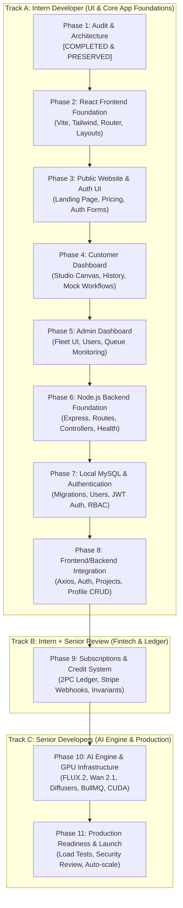

# Development Roadmap & Implementation Plan (Aligned 11-Phase Sequence)

**Document Version:** 2.0.0  
**Status:** Approved for Implementation Sequence  
**Alignment Date:** November 2026  
**Project Horizon:** 11 Phased Milestones (Beginner-Friendly Foundation $\rightarrow$ Senior AI Integration)  
**Target Roles:** Intern Developer (Phases 2–8, Co-lead Phase 9) | Senior Infrastructure & AI Architects (Review Phase 9, Lead Phases 10–11)  

---

## 1. Executive Strategy & Team Alignment

To ensure high-velocity delivery without introducing premature operational bottlenecks, the master development sequence has been officially realigned. 

### Core Team & Execution Principles:
1. **Intern-First Execution Order:** The primary developer currently building the system is an intern developer utilizing the Antigravity pairing agent. The implementation order strictly prioritizes modular, independently testable React components, standard Express APIs, and local MySQL schemas.
2. **Deferred Advanced Infrastructure:** Complex distributed infrastructure (Docker container orchestration, Redis, BullMQ, Python PyTorch inference microservices, CUDA drivers, ComfyUI, dedicated GPU workers, and S3-compatible cloud storage) is **strictly deferred** to Phase 10 and Phase 11, where senior engineers will join to implement and harden them.
3. **No Unnecessary Complexity:** Pure React with Vite, JavaScript JSX, and Tailwind CSS on the frontend. Node.js, Express, and local MySQL on the backend. **Strictly NO Next.js, NO TypeScript, and NO external generative AI API wrappers.**
4. **Mock-Data Isolation:** Frontend studio interfaces, asset galleries, and admin monitors developed during Phases 2–5 will operate with structured, clearly labeled mock fixtures. Real AI workers will only be connected in Phase 10.
5. **Preservation of Target Architecture:** All deep-dive technical research and production-grade architectures designed in Phase 1 ([`PROJECT_PRD.md`](file:///c:/Users/Kiaan%20technology/Desktop/AI%20image%20video/docs/PROJECT_PRD.md), [`AI_MODEL_COMPARISON.md`](file:///c:/Users/Kiaan%20technology/Desktop/AI%20image%20video/docs/AI_MODEL_COMPARISON.md), [`SYSTEM_ARCHITECTURE.md`](file:///c:/Users/Kiaan%20technology/Desktop/AI%20image%20video/docs/SYSTEM_ARCHITECTURE.md), [`DATABASE_DESIGN.md`](file:///c:/Users/Kiaan%20technology/Desktop/AI%20image%20video/docs/DATABASE_DESIGN.md), [`API_SPECIFICATION.md`](file:///c:/Users/Kiaan%20technology/Desktop/AI%20image%20video/docs/API_SPECIFICATION.md), [`GPU_INFRASTRUCTURE.md`](file:///c:/Users/Kiaan%20technology/Desktop/AI%20image%20video/docs/GPU_INFRASTRUCTURE.md), [`SUBSCRIPTION_CREDIT_SYSTEM.md`](file:///c:/Users/Kiaan%20technology/Desktop/AI%20image%20video/docs/SUBSCRIPTION_CREDIT_SYSTEM.md), and [`SECURITY_AND_LICENSING.md`](file:///c:/Users/Kiaan%20technology/Desktop/AI%20image%20video/docs/SECURITY_AND_LICENSING.md)) remain the authoritative target blueprint.

---

## 2. Master 11-Phase Implementation Workflow



---

## 3. Phase-by-Phase Detailed Specifications

### PHASE 1 — AUDIT & ARCHITECTURE
- **Status:** **100% COMPLETED AND REPORTED.**
- **Assigned Role:** Principal Architects.
- **Deliverables:** Nine foundational architecture documents produced and preserved in [`docs/`](file:///c:/Users/Kiaan%20technology/Desktop/AI%20image%20video/docs). Greenfield workspace verified.

---

### PHASE 2 — REACT FRONTEND FOUNDATION
- **Goal:** Establish a clean, responsive, modular Single Page Application (SPA) foundation with routing, layouts, and shared design primitives.
- **Assigned Role:** Intern Developer.
- **Prerequisites:** Phase 1 sign-off.
- **Key Tasks:**
  1. Initialize React application using Vite: `npm create vite@latest . -- --template react` (Pure JavaScript JSX).
  2. Install and configure Tailwind CSS with custom color palette (dark studio aesthetic, modern neutral borders, accent blues/violets).
  3. Install core dependencies: `react-router-dom`, `lucide-react`, `clsx`, `tailwind-merge`.
  4. Create shared UI design system components:
     - Button (variants: primary, secondary, danger, ghost; loading spinner).
     - Input, TextArea, Select, Switch, Badge, Modal, Tooltip, Dropdown.
  5. Build responsive shell layouts:
     - `PublicLayout`: Header with logo, nav links, and CTA; footer.
     - `CustomerLayout`: Collapsible sidebar, top bar with breadcrumbs and credit badge, main content area.
     - `AdminLayout`: Specialized administrative sidebar, system status banner, top bar.
  6. Configure React Router with route placeholders and 404 page.
  7. Verify clean build (`npm run build`) without errors or warnings.
- **Constraints:** No backend connections. No database logic. Pure frontend scaffolding.
- **Acceptance Criteria:**
  - `npm run dev` serves the application at `http://localhost:5173`.
  - Navigation between Public, Customer, and Admin shell layouts works seamlessly via browser URLs.
  - Zero TypeScript errors (JavaScript only). `npm run build` generates clean production assets in `/dist`.

---

### PHASE 3 — PUBLIC WEBSITE & AUTHENTICATION UI
- **Goal:** Deliver an aesthetically stunning, modern SaaS landing page and complete authentication user flows.
- **Assigned Role:** Intern Developer.
- **Prerequisites:** Phase 2 completed and verified.
- **Key Tasks:**
  1. Build Public Landing Page:
     - **Hero Section:** Value proposition, animated preview mockup, primary CTA buttons ("Start Creating Free", "Explore Models").
     - **Feature Showcase:** Grid highlighting T2I, I2I, inpainting, T2V, and I2V capabilities.
     - **Interactive Model Showcase:** Cards highlighting FLUX.2 Klein 4B, Z-Image Turbo, and Wan 2.1 Video with sample outputs.
     - **Pricing Comparison Table:** Free, Creator ($19/mo), Pro Studio ($49/mo), and Enterprise ($199/mo) cards.
     - **Social Proof / Testimonials Section:** Creator reviews and generation statistics.
     - **FAQ Accordion:** Common questions regarding commercial rights, credits, and speeds.
  2. Build Authentication & Account Flow Pages:
     - `LoginPage`: Email/password form, "Remember Me", "Forgot Password?" link, validation states.
     - `RegisterPage`: Name, email, password strength meter, Terms checkbox.
     - `ForgotPasswordPage` & `ResetPasswordPage`.
     - `PrivacyPolicyPage` & `TermsOfServicePage`.
- **Constraints:** UI only. Use local component state or mock handlers for form submissions. Real JWT authentication comes in Phase 7.
- **Acceptance Criteria:**
  - All public pages are 100% mobile-responsive and visually cohesive in dark/light mode.
  - Forms display real-time validation feedback (e.g., invalid email format, short password).
  - Navigation links correctly route between public pages and auth forms.

---

### PHASE 4 — CUSTOMER DASHBOARD
- **Goal:** Create the complete studio workspace, generative interfaces, asset galleries, and account management views for end users.
- **Assigned Role:** Intern Developer.
- **Prerequisites:** Phase 3 completed.
- **Key Tasks:**
  1. **Customer Overview:** Quick-start cards, recent generations carousel, credit balance overview, and active job status widget.
  2. **Text-to-Image (T2I) Studio Interface:**
     - Prompt bar with auto-expand and negative prompt toggle.
     - Aspect ratio selector (1:1, 16:9, 9:16, 4:3, 3:4).
     - Parameter sidebar: Steps (1–8 for distilled models), CFG scale, Seed (random/lock), model dropdown.
     - Canvas preview area with mock generation progress bar and sample outputs.
  3. **Image-to-Image (I2I) & Inpainting Interface:**
     - Drag-and-drop reference image uploader.
     - Strength / influence slider.
     - HTML5 canvas masking brush for inpainting regions.
  4. **Text-to-Video & Image-to-Video Studio Interface:**
     - Video prompt input, duration selector (3s / 5s), frame rate presets, motion intensity slider.
     - Keyframe upload slot for Image-to-Video.
     - Video player preview area with playback controls.
  5. **Generation History & Asset Gallery:**
     - Grid layout with infinite scroll simulation and filtering (All, Images, Videos, Favorites).
     - Detail modal: Full-resolution viewer, metadata drawer (seed, prompt, model, date, cost), copy prompt, download button.
  6. **Project & Folder Organization UI:** Folder tree navigation, create folder modal, move asset to folder.
  7. **Credits & Subscription Pages:** Credit balance counter, usage graphs, upgrade plan cards, top-up pack selector.
  8. **Profile & Settings:** User avatar, name, email, password update, API key generation mockup, notification toggles.
  9. **Support & Feedback View:** Ticket submission form and FAQ search.
- **Constraints:** Use clearly labeled mock data fixtures (`src/mocks/customerData.js`). Do not call real AI endpoints.
- **Acceptance Criteria:**
  - User can interact with all studio controls, toggle options, switch modes, and adjust sliders smoothly.
  - Clicking "Generate" simulates a job submission (shows loading state, progress bar, and inserts a mock asset into history).
  - Clean separation of UI components into modular folders (`src/components/studio/`, `src/components/gallery/`).

---

### PHASE 5 — ADMIN DASHBOARD
- **Goal:** Provide system administrators with comprehensive control interfaces to monitor fleet metrics, manage users, and inspect jobs.
- **Assigned Role:** Intern Developer.
- **Prerequisites:** Phase 4 completed.
- **Key Tasks:**
  1. **Admin Overview:** KPI summary cards (Total Users, Active Subscriptions, Total Generations Today, Estimated Revenue, Worker Health).
  2. **User Management UI:** Searchable data table, pagination, status badges (`ACTIVE`, `SUSPENDED`), view user details modal, adjust credits modal.
  3. **Subscription Plan Management UI:** Edit plan pricing, credit allotments, and feature lists.
  4. **Credit Management UI:** Filterable ledger of credit transactions, manual credit grant/deduct actions.
  5. **Job Monitoring UI:** Live table of image and video generation jobs, status filters (`QUEUED`, `RUNNING`, `COMPLETED`, `FAILED`), execution time.
  6. **AI Model Registry UI:** List registered models (`FLUX.2 Klein`, `Z-Image Turbo`, `Wan 2.1`), toggle model active status, set credit costs.
  7. **GPU Fleet Monitoring UI:** Hardware cards showing worker hostname, pool type (`IMAGE_POOL` / `VIDEO_POOL`), VRAM progress bar, GPU temp, worker drain button.
  8. **Queue Monitoring UI:** Visual gauge of BullMQ queue depths, waiting times, and active workers.
  9. **Revenue & Payment Analytics UI:** MRR chart, credit purchase volume, top-up pack distribution.
  10. **Failed Jobs & Dead-Letter Queue (DLQ) UI:** Error logs inspection, retry job button, view stack traces.
  11. **Security & Audit Logs UI:** Searchable table of authentication attempts, moderation blocks, and admin actions.
  12. **System Settings UI:** Global maintenance mode toggle, pre-inference moderation sensitivity slider.
- **Constraints:** Use realistic mock data fixtures (`src/mocks/adminData.js`). No fabricated live GPU drivers or real financial charges.
- **Acceptance Criteria:**
  - Admin table components feature working sorting, text filtering, and pagination controls.
  - Action buttons (e.g., "Drain Worker", "Suspend User", "Retry Job") trigger confirmation dialogs and update local UI state.

---

### PHASE 6 — NODE.JS BACKEND FOUNDATION
- **Goal:** Establish a clean, modular Express.js REST API server with standardized error handling, request validation, and environment configuration.
- **Assigned Role:** Intern Developer.
- **Prerequisites:** Phase 5 completed.
- **Key Tasks:**
  1. Initialize backend project: `package.json` with Node.js 20 LTS.
  2. Install core packages: `express`, `cors`, `helmet`, `dotenv`, `morgan`, `winston`, `express-validator`.
  3. Establish modular folder structure:
     ```
     server/
     ├── src/
     │   ├── config/          # Environment variables & constants
     │   ├── controllers/     # HTTP request handlers
     │   ├── middleware/      # Auth, validation, error handler
     │   ├── routes/          # Express route definitions
     │   ├── services/        # Business logic
     │   ├── utils/           # Logger, standard response helpers
     │   └── app.js           # Express app setup
     ├── tests/               # Automated unit/integration tests
     ├── .env.example
     └── server.js            # Entry point
     ```
  4. Implement centralized error-handling middleware (`ApiError`, standard `{ success: false, error: {...} }` format).
  5. Implement standard success response helper (`{ success: true, data: {...}, meta: {...} }`).
  6. Implement request validation middleware using `express-validator`.
  7. Implement system health endpoint: `GET /api/v1/health` (returns uptime, memory, timestamp).
  8. Write basic automated integration tests using Jest / Supertest.
- **Constraints:** No AI inference code. No direct database queries yet (use mock service responses in Phase 6).
- **Acceptance Criteria:**
  - `npm start` launches server on port 5000 with structured JSON logging.
  - `GET /api/v1/health` returns `200 OK` with JSON envelope.
  - Automated tests pass with 100% success for health and error middleware.

---

### PHASE 7 — LOCAL MYSQL & AUTHENTICATION
- **Goal:** Deploy local MySQL database migrations, establish data access layer, and implement full JWT authentication with role-based authorization.
- **Assigned Role:** Intern Developer.
- **Prerequisites:** Phase 6 completed.
- **Key Tasks:**
  1. Configure local MySQL 8.0 instance and `.env` credentials.
  2. Implement version-controlled database migrations (using `knex` or raw SQL migration runner) for:
     - `roles`, `permissions`, `role_permissions`.
     - `users`, `credit_wallets`.
     - Seed default roles: `user`, `creator`, `admin`, `super_admin`.
  3. Install security dependencies: `bcryptjs`, `jsonwebtoken`, `cookie-parser`.
  4. Implement Authentication Endpoints:
     - `POST /api/v1/auth/register` (Password hashing with bcrypt 12 salt rounds, auto-creation of zero-balance credit wallet).
     - `POST /api/v1/auth/login` (Verify password, issue access token + httpOnly refresh token cookie).
     - `POST /api/v1/auth/refresh` (Rotate refresh token, issue new access token).
     - `POST /api/v1/auth/logout` (Clear cookie).
     - `GET /api/v1/auth/me` (Return authenticated user & role).
  5. Implement Auth Middleware:
     - `verifyToken`: Validates JWT Bearer header.
     - `requireRole(['admin'])`: Enforces role-based permissions.
  6. Implement Profile CRUD: `GET /api/v1/users/profile`, `PATCH /api/v1/users/profile`.
  7. Write automated tests for registration, valid login, invalid password, and protected route access.
- **Constraints:** Local MySQL only. Never access production databases.
- **Acceptance Criteria:**
  - Database migrations run cleanly and create normalized tables with foreign keys.
  - Automated tests verify password hashing, token issuance, and 401/403 rejection for unauthenticated requests.

---

### PHASE 8 — FRONTEND/BACKEND INTEGRATION
- **Goal:** Connect the React frontend to the live Express/MySQL backend, replacing mock authentication and user management with real REST APIs.
- **Assigned Role:** Intern Developer.
- **Prerequisites:** Phase 7 completed.
- **Key Tasks:**
  1. Configure `axios` instance in React with base URL (`http://localhost:5000/api/v1`) and request/response interceptors:
     - Interceptor attaches `Authorization: Bearer <token>` from memory.
     - Response interceptor catches 401s and attempts silent token refresh via `/auth/refresh`.
  2. Connect Authentication Flows:
     - React Login and Register forms communicate with Express backend.
     - Store user session in React Context (`AuthContext`).
  3. Implement `ProtectedRoute` wrapper component (redirects unauthenticated users to `/login`).
  4. Implement `AdminRoute` wrapper component (redirects non-admin users to `/dashboard`).
  5. Connect User Profile and Settings page to live backend.
  6. Implement Projects & Folders CRUD endpoints in Express + MySQL and connect to Customer Studio UI.
  7. Connect Admin User Management data table to backend `GET /api/v1/admin/users`.
  8. Handle all loading spinners, API error alerts, and empty data states gracefully.
- **Constraints:** AI generation endpoints must return a mock or "Queued (AI Workers Not Connected)" state. Do not connect GPU workers.
- **Acceptance Criteria:**
  - A user can register a new account on the frontend, log in, view their real profile, create a project folder, and log out.
  - Admin accounts can view registered users in the admin dashboard.
  - End-to-end integration verified locally in browser.

---

### PHASE 9 — SUBSCRIPTIONS & CREDIT SYSTEM
- **Goal:** Implement the double-entry credit ledger, two-phase reservation protocol, subscription plan CRUD, and Stripe billing integration.
- **Assigned Role:** Intern Developer + **Mandatory Senior Architect Review**.
- **Prerequisites:** Phase 8 completed.
- **Key Tasks:**
  1. Run MySQL migrations for `plans`, `subscriptions`, `payments`, and `credit_transactions` (as designed in [`DATABASE_DESIGN.md`](file:///c:/Users/Kiaan technology/Desktop/AI%20image%20video/docs/DATABASE_DESIGN.md)).
  2. Implement Two-Phase Commit (2PC) Credit Wallet Service:
     - `reserveCredits(userId, cost, jobId)`: Acquires `SELECT ... FOR UPDATE` row lock, verifies `(balance - reserved) >= cost`, increments `reserved_credits`, and records `RESERVE` transaction.
     - `settleCredits(userId, cost, jobId)`: Deducts from both `balance` and `reserved_credits`, records `SETTLE` transaction.
     - `refundCredits(userId, cost, jobId)`: Unlocks `reserved_credits` without modifying balance, records `REFUND` transaction.
  3. Implement Idempotency Guard: Validate `Idempotency-Key` header against `credit_transactions` to eliminate duplicate operations.
  4. Implement Stripe Billing Webhook Handler:
     - `POST /api/v1/webhooks/stripe` with raw body signature verification (`stripe.webhooks.constructEvent`).
     - Handle `checkout.session.completed` (subscription creation & top-up grants).
     - Handle `invoice.payment_succeeded` (monthly credit renewals).
     - Handle `invoice.payment_failed` & `customer.subscription.deleted`.
  5. Connect React Credit Display & Top-Up UI to live backend and Stripe Checkout redirect.
  6. Write automated concurrency tests (simulate 20 concurrent requests with insufficient balance to verify zero negative balances).
  7. **Senior Architecture Review:** Senior lead audits financial invariants, transaction isolation, and webhook signature verification before sign-off.
- **Constraints:** Financially sensitive. Requires senior architectural review before production readiness.
- **Acceptance Criteria:**
  - 100% of credit operations are backed by immutable transaction ledger records.
  - Concurrency tests prove zero race conditions, negative balances, or double-spends.
  - Senior architect officially approves ledger code.

---

### PHASE 10 — AI ENGINE & GPU INFRASTRUCTURE
- **Goal:** Build the self-hosted AI inference worker fleet, connect Redis/BullMQ distributed job scheduling, load open-weight models, and deliver real generations.
- **Assigned Role:** **Senior AI Infrastructure Architects & ML Engineers** (Intern assists/observes).
- **Prerequisites:** Phase 9 completed.
- **Key Tasks:**
  1. Re-verify commercial licenses for all downloaded weights (Apache 2.0).
  2. Provision GPU worker hardware (NVIDIA RTX 4090 / A100 80GB).
  3. Deploy Redis 7.0 and BullMQ queue partitions (`queue:image:priority`, `queue:image:standard`, `queue:video:*`).
  4. Build Python GPU Worker Microservices:
     - `image_worker.py`: Hugging Face `diffusers`, PyTorch 2.4+, CUDA 12.x, FP8 quantization, FlashAttention-2.
     - Primary model: `FLUX.2-klein-4B`. Secondary model: `Z-Image-Turbo`.
     - `video_worker.py`: `Wan2.1-T2V-1.3B` (draft 480p) and `Wan2.1-T2V-14B` (cinema 720p).
  5. Deploy S3-compatible Object Storage (MinIO / Cloudflare R2) and direct worker upload pipeline.
  6. Implement Server-Sent Events (SSE) bridge: Redis event stream $\rightarrow$ Express $\rightarrow$ React frontend.
  7. Implement Two-Tier Content Moderation (pre-inference regex/classifier + post-inference safety checker).
  8. Perform model inference latency and VRAM footprint benchmarking.
- **Constraints:** No third-party generative AI APIs. Self-hosted weights only.
- **Acceptance Criteria:**
  - Real FLUX.2 Klein generation runs end-to-end: User prompt $\rightarrow$ Credit reservation $\rightarrow$ BullMQ $\rightarrow$ GPU inference $\rightarrow$ S3 upload $\rightarrow$ SSE stream $\rightarrow$ Credit settlement $\rightarrow$ Image displayed in React studio.
  - Average cycle time $\le 1.5$ seconds for standard images on RTX 4090.

---

### PHASE 11 — PRODUCTION READINESS & LAUNCH
- **Goal:** Harden security, configure auto-scaling, establish automated backups, execute load testing, and deploy to production.
- **Assigned Role:** **Senior Architects & Full Engineering Team**.
- **Prerequisites:** Phase 10 completed and verified.
- **Key Tasks:**
  1. Comprehensive OWASP Top 10 penetration testing and dependency security audit.
  2. Distributed Redis token-bucket rate limiting on all public and API endpoints.
  3. Load testing via k6: Benchmark 1,000 req/sec on gateway and 5,000 jobs in BullMQ.
  4. Worker chaos failover drills: Verify watchdog detects crashed workers and cleanly refunds credits.
  5. Production deployment setup: Docker container registries, CI/CD pipelines via GitHub Actions, reverse proxy with SSL and Cloudflare WAF.
  6. Automated database backup configuration (daily logical snapshots + continuous binary log archiving).
  7. Staged private beta launch with 50 creators, followed by public launch.
- **Acceptance Criteria:**
  - Platform achieves 99.5% uptime during 72-hour continuous stress testing.
  - Zero critical security vulnerabilities.
  - Production sign-off from Principal Architect and Project Owner.

---

## 4. Responsibility Matrix (RACI)

| Phase | Phase Name | Primary Lead | Supporting Role | Senior Sign-Off Required |
| :---: | :--- | :---: | :---: | :---: |
| **Phase 1** | Audit & Architecture | Principal Architect | Full Team | Yes (Completed) |
| **Phase 2** | React Frontend Foundation | **Intern** | Antigravity AI | No |
| **Phase 3** | Public Website & Auth UI | **Intern** | Antigravity AI | No |
| **Phase 4** | Customer Dashboard | **Intern** | Antigravity AI | No |
| **Phase 5** | Admin Dashboard | **Intern** | Antigravity AI | No |
| **Phase 6** | Node.js Backend Foundation | **Intern** | Antigravity AI | No |
| **Phase 7** | Local MySQL & Authentication | **Intern** | Antigravity AI | No |
| **Phase 8** | Frontend/Backend Integration | **Intern** | Antigravity AI | No |
| **Phase 9** | Subscriptions & Credit System | **Intern** | **Senior Architect** | **YES** |
| **Phase 10**| AI Engine & GPU Infrastructure | **Senior AI Lead** | Intern | **YES** |
| **Phase 11**| Production Readiness & Launch | **Senior Architect** | Full Team | **YES** |
