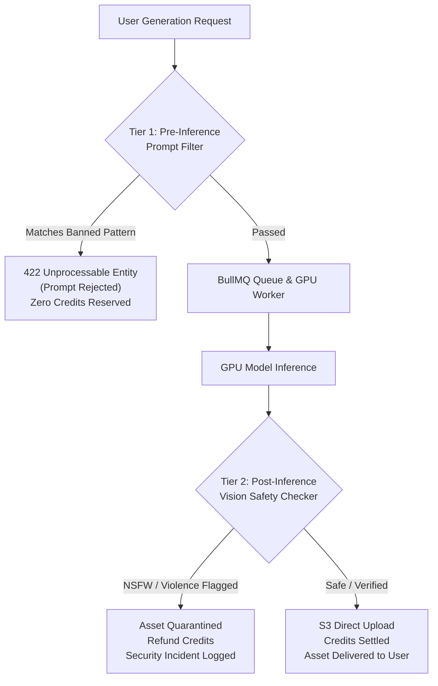
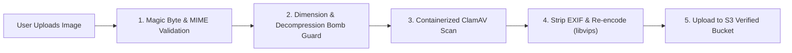

# Security Architecture, Commercial Compliance & Licensing Manual

**Document Version:** 1.0.0  
**Status:** Approved for Architecture & Planning (Phase 1)  
**Author:** Principal Security Architect & Legal Compliance Lead  
**Scope:** Model licensing compliance, infrastructure defense-in-depth, content moderation, file upload security, and disaster recovery.

---

## 1. Open-Source AI Model Licensing & Commercial SaaS Compliance

Operating a commercial generative AI SaaS requires absolute legal certainty regarding model licenses. Deploying non-commercial or ambiguously licensed models exposes the platform to cease-and-desist orders, copyright infringement lawsuits, and retroactive royalty claims.

### 1.1 Commercial Compliance Matrix

| Model Identifier | Author / Organization | Official License | Commercial SaaS Status | Mandatory Compliance Obligations |
| :--- | :--- | :--- | :--- | :--- |
| **FLUX.2 Klein 4B** | Black Forest Labs | **Apache License 2.0** | **APPROVED (100% Commercial)** | Retain copyright notice, Apache 2.0 license text, and disclaimer of warranty in software documentation. |
| **Z-Image Turbo** | Alibaba Tongyi Lab | **Apache License 2.0** | **APPROVED (100% Commercial)** | Retain Apache 2.0 attribution notices and patent grant notices. |
| **Wan 2.1 & 2.2 Suite** | Alibaba Wan-AI | **Apache License 2.0** | **APPROVED (100% Commercial)** | Retain Apache 2.0 notices. Ensure generated content does not violate local laws or harm vulnerable populations. |
| **FLUX.1 [schnell]** | Black Forest Labs | **Apache License 2.0** | **APPROVED (Commercial Alternate)**| Apache 2.0 attribution. |
| **FLUX.1 [dev]** | Black Forest Labs | **FLUX.1-dev Non-Commercial** | **STRICTLY PROHIBITED** | Commercial hosting and SaaS monetization strictly forbidden without paid enterprise license. |
| **Stable Diffusion 3.5** | Stability AI | **Stability AI Community** | **REJECTED** | Restricted commercial use capped at $1M revenue; requires enterprise agreement above ceiling. |

### 1.2 Output Ownership & Copyright
- Under the terms of the Apache 2.0 license, the model authors claim **zero copyright ownership** over images and video sequences generated by end users.
- Our Terms of Service (ToS) grant full ownership and commercial exploitation rights of generated visual media to the creating user, provided their inputs do not infringe third-party intellectual property.

---

## 2. Content Moderation & Abuse Prevention Architecture

To prevent platform misuse (e.g., generation of CSAM, non-consensual sexual content, terrorism, hate speech, or real-world violence), a **Two-Tier Moderation Pipeline** is enforced.

### 2.1 Tier 1: Pre-Inference Text Prompt Filtering
- **Execution Point:** API Gateway middleware prior to database credit reservation.
- **Mechanisms:**
  1. **Deterministic Regex Blacklist:** Instant blocking of explicit terms, illegal exploitation keywords, and known malicious jailbreak strings.
  2. **Fast Semantic Text Classifier:** Lightweight transformer model (e.g., DistilBERT running on CPU) evaluating prompt embeddings against unsafe category vectors ($P_{\text{unsafe}} > 0.85$ triggers rejection).
- **Latency Impact:** $< 15$ms overhead.

### 2.2 Tier 2: Post-Inference Latent & Vision Safety Checker
- **Execution Point:** GPU Worker immediately following VAE decoding and before S3 upload.
- **Mechanisms:**
  1. **Diffusers Safety Checker / Q16:** Evaluates output pixel tensors against harmful concept cosine distance thresholds.
  2. **Perceptual Hashing (PhotoDNA / PDQ):** Checks against known prohibited image hash registries.
- **Action upon Violation:** If flagged, the raw media file is immediately wiped from worker memory, marked `QUARANTINED` in database logs, the job is canceled, and reserved credits are automatically unlocked to prevent user dispute. Repeated violations trigger automated account suspension.

---

## 3. Secure File Upload Pipeline (Image-to-Image / Inpainting)

Allowing user image uploads introduces critical vulnerabilities (malicious payloads, pixel bombs, polyglot files, remote code execution). All uploads pass through a dedicated zero-trust sanitization pipeline:

1. **Magic-Byte Inspection:** The API inspects the binary header bytes (`file-type` parser), rejecting files whose internal bytes do not match standard JPEG, PNG, or WebP magic signatures regardless of the user-supplied file extension.
2. **Decompression Bomb Protection:** Images are checked for deceptive dimensions ($W \times H \le 4096 \times 4096$; file size $\le 15$ MB) before allocating decompression buffers in memory.
3. **Containerized Antivirus Scanning:** Uploaded buffers are scanned asynchronously via ClamAV daemon running in an isolated sidecar container.
4. **EXIF Stripping & Pixel Re-encoding:** Images are parsed with `libvips` / `sharp`, all EXIF/XMP metadata (GPS coordinates, camera serials, embedded comments) is stripped, and the image is re-encoded into clean WebP before storage.

---

## 4. GPU Worker Sandboxing & Isolation

Inference workers execute complex third-party Python C-extensions, CUDA kernels, and deep learning libraries. To mitigate container escapes or model injection vulnerabilities:

1. **Non-Root Execution:** Worker processes run under an unprivileged user (`uid: 10001`, `gid: 10001`) with no sudo access.
2. **Read-Only Root Filesystem:** Worker containers run with `--read-only`. Only `/tmp` (ephemeral tmpfs) and `/models/weights` (read-only volume mount) are writable/readable.
3. **Network Perimeter Isolation:** GPU workers reside inside a private Docker bridge / VPC subnet. They have **zero direct access to the public internet**. Outbound connections are firewall-whitelisted exclusively to the internal Redis queue host and the S3 storage endpoint.
4. **No Arbitrary Code Execution:** Workers reject arbitrary Python scripts, pickled weights, or unverified checkpoint files. Only pre-verified `.safetensors` model weights with cryptographically verified SHA-256 hashes are loaded into memory.

---

## 5. Authentication, RBAC & API Defense

### 5.1 Dual-Token JWT Lifecycle
- **Access Token:** Short-lived (15 minutes), signed using HMAC-SHA256 (`HS256`) or RSA (`RS256`). Stored solely in browser client memory (React state); never stored in localStorage to prevent XSS exfiltration.
- **Refresh Token:** Long-lived (7 days), stored in an `httpOnly`, `Secure`, `SameSite=Strict` cookie path-restricted to `/api/v1/auth/refresh`. Revocable in Redis via token family rotation.

### 5.2 Role-Based Access Control (RBAC) Matrix

| Resource / Endpoint | Public User | Creator (Free/Paid) | Agency Admin | Super Admin |
| :--- | :---: | :---: | :---: | :---: |
| **Browse / View Public Gallery** | Allowed | Allowed | Allowed | Allowed |
| **Submit Generation Jobs** | Denied | Allowed (with credits) | Allowed | Allowed |
| **Manage Own Assets & Projects** | Denied | Allowed | Allowed | Allowed |
| **Access Team / Agency Workspace**| Denied | Denied | Allowed | Allowed |
| **View GPU Fleet & Queue Telemetry**| Denied | Denied | Denied | Allowed |
| **Adjust User Credits / Ban Accounts**| Denied | Denied | Denied | Allowed |

### 5.3 Distributed Rate Limiting
Backed by Redis token bucket algorithm (`rate-limiter-flexible`):
- **Public Auth Routes:** 10 requests / minute per IP (prevents brute force).
- **Generation Submission:** 20 requests / minute per user account.
- **Standard Read APIs:** 120 requests / minute per user account.
- **Admin APIs:** 300 requests / minute per admin session.

---

## 6. Payment Security & PCI-DSS Compliance

- **Zero Cardholder Data Storage:** The SaaS platform never ingests, transmits, or stores credit card numbers, CVVs, or cardholder banking data.
- **Stripe Hosted Checkout & Elements:** All payment inputs are captured inside Stripe's PCI-DSS Level 1 compliant iframes.
- **Cryptographic Webhook Signatures:** All Stripe webhook payloads are verified using `stripe.webhooks.constructEvent(payload, headerSignature, webhookSecret)` to prevent forged balance top-ups.

---

## 7. Storage Permissions, Backups & Disaster Recovery

### 7.1 Object Storage Security
- Media storage buckets (`antigravity-media`) have public access strictly disabled (`BlockPublicAccess: true`).
- Direct client downloads utilize short-lived HMAC-signed Presigned URLs with a maximum Time-To-Live (TTL) of 900 seconds (15 minutes).

### 7.2 Backup & Recovery Objectives
- **Recovery Point Objective (RPO):** $< 15$ minutes.
- **Recovery Time Objective (RTO):** $< 2$ hours.
- **Database Backup Strategy:**
  - Automated full logical snapshot taken daily at 02:00 UTC using `mysqldump` with `--single-transaction`, compressed, and shipped off-site to encrypted secondary storage.
  - Continuous MySQL binary log replication (`binlog`) streamed every 5 minutes to allow Point-In-Time Recovery (PITR) to any arbitrary second.
- **Model Weight Redundancy:** Model weights are stored in read-only immutable storage and replicated across local NVMe storage arrays.

