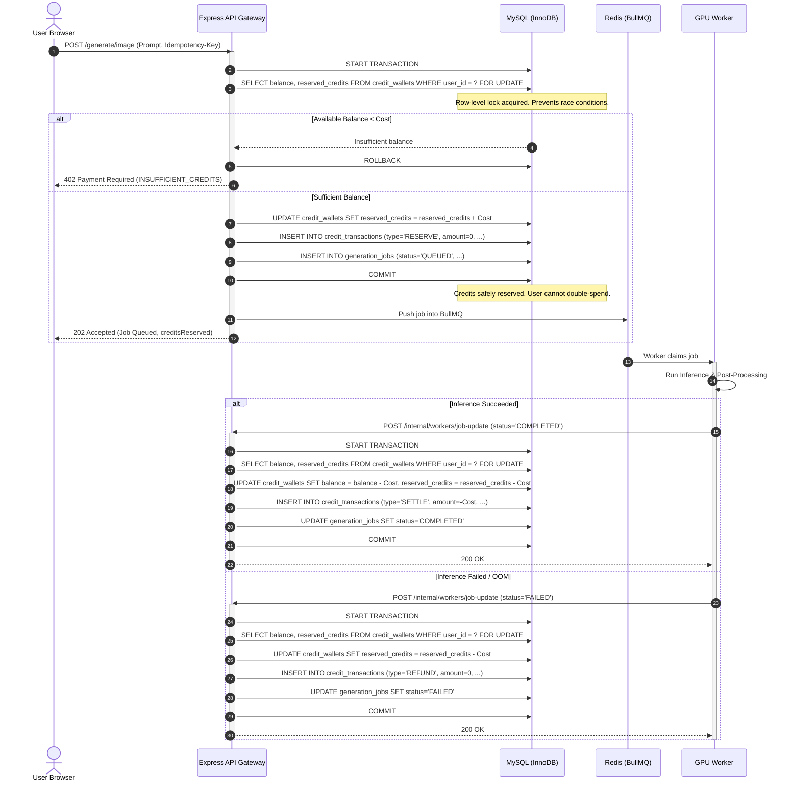

# Subscription & Credit Engine Architecture

**Document Version:** 1.0.0  
**Status:** Approved for Architecture & Planning (Phase 1)  
**Author:** Principal SaaS Architect & Financial Systems Lead  
**Scope:** Complete economic model, transactional ledger mechanics, two-phase reservation protocol, concurrency protection, and billing integration.

---

## 1. Credit Economy & Pricing Model

The platform operates on a unified, real-time credit currency. Credits decouple user payments from underlying hardware fluctuations, enabling transparent cross-model pricing.

### 1.1 Granular Generation Credit Cost Table

| Model & Task Type | Output Specifications | Compute Footprint | Credit Cost | Effective Cost to User ($0.03/cr) |
| :--- | :--- | :--- | :--- | :--- |
| **FLUX.2 Klein 4B (Draft/Standard)** | 1024×1024, 4 steps, FP8 | ~1.1s (RTX 4090) | **1 Credit** | **$0.03** |
| **FLUX.2 Klein 4B (High-Res Fix)** | 1536×1536 to 2048×2048 | ~2.5s (RTX 4090) | **2 Credits** | **$0.06** |
| **FLUX.2 Klein 4B (Inpainting/Mask)** | 1024×1024 with reference | ~1.5s (RTX 4090) | **2 Credits** | **$0.06** |
| **Z-Image Turbo** | 1024×1024, 8 steps | ~2.2s (RTX 4090) | **1 Credit** | **$0.03** |
| **Wan 2.1 1.3B (Fast Draft Video)** | 854×480 (480p), 5.0s, 81 frames | ~22s (RTX 4090) | **12 Credits** | **$0.36** |
| **Wan 2.1 14B (Cinema Video)** | 1280×720 (720p), 5.0s, 81 frames | ~45s (A100 80GB) | **25 Credits** | **$0.75** |
| **Wan 2.2 MoE (High-Definition Video)**| 1280×720 (720p), 5.0s, 81 frames | ~55s (A100 80GB) | **40 Credits** | **$1.20** |

---

## 2. Subscription Tiers & One-Time Top-Up Packs

### 2.1 Monthly Recurring Plans

| Plan Feature | Free Trial / Starter | Creator Tier | Pro Studio Tier | Enterprise Tier |
| :--- | :--- | :--- | :--- | :--- |
| **Monthly Price** | **$0.00 / month** | **$19.00 / month** | **$49.00 / month** | **$199.00 / month** |
| **Monthly Credits Granted** | 25 (one-time grant) | 600 credits / mo | 2,000 credits / mo | 10,000 credits / mo |
| **Effective Price / Credit** | $0.00 | $0.0316 | $0.0245 | $0.0199 |
| **Concurrent Active Jobs** | 1 job | 2 concurrent jobs | 5 concurrent jobs | 20 concurrent jobs |
| **Queue Priority Level** | Standard (Level 1) | Elevated (Level 3) | Priority (Level 5) | Dedicated Fast-Track (Level 10) |
| **Video Generation Access** | Draft 480p only | Draft 480p + Cinema 720p | Full Access (All Models) | Full Access + Private Worker |
| **Commercial Asset Usage** | Non-commercial | Full Commercial Rights | Full Commercial Rights | Full Commercial Rights |
| **Asset Storage Retention** | 14 days | 90 days | Unlimited | Unlimited |

### 2.2 One-Time Credit Top-Up Packs
Subscribers can top up their wallet at any time without changing their base tier:
- **Small Pack:** 250 credits for **$9.00** ($0.036 / credit).
- **Medium Pack:** 750 credits for **$24.00** ($0.032 / credit).
- **Pro Pack:** 2,000 credits for **$59.00** ($0.0295 / credit).
- **Studio Pack:** 5,000 credits for **$129.00** ($0.0258 / credit).

---

## 3. Two-Phase Commit Transactional Ledger

To ensure zero phantom spends, race conditions, or unearned credit deductions, the platform employs a strict **Two-Phase Commit (2PC) Ledger Pattern**.



---

## 4. Concurrency Protection & Integrity Invariants

### 4.1 Invariant Rules
1. **Available Balance Invariant:**  
   $$\text{Available Credits} = \text{Balance} - \text{Reserved Credits}$$
2. **Non-Negative Constraints:**  
   Enforced at the MySQL engine level via database schema check constraints:
   ```sql
   CONSTRAINT `chk_balance_non_negative` CHECK (`balance` >= 0)
   CONSTRAINT `chk_reserved_non_negative` CHECK (`reserved_credits` >= 0)
   ```
3. **Pessimistic Row-Level Locking:**  
   All balance reads during mutation use `SELECT ... FOR UPDATE`. If a user fires 10 simultaneous generation requests with only 1 credit in their wallet, exactly 1 request will acquire the lock, pass validation, and reserve the credit. The remaining 9 requests will be blocked at the lock, re-read the updated available balance ($0$), fail validation, and return `402 Payment Required`.

### 4.2 Idempotency Engine
- Clients generate a UUIDv4 `Idempotency-Key` header with each submission.
- The `credit_transactions` table enforces a `UNIQUE KEY (idempotency_key)`.
- If a network dropout causes the client to retry the request with the identical key:
  1. The API catches the `ER_DUP_ENTRY` MySQL exception.
  2. The API queries the existing job associated with that idempotency key.
  3. The API returns the already created job payload (`200 OK`) without re-reserving credits or triggering duplicate GPU jobs.

---

## 5. Stripe Billing Integration & Webhook Lifecycle

The platform uses Stripe Billing for subscription lifecycle and credit top-ups.

### Handled Webhook Events:
1. `checkout.session.completed`:
   - Checks if `mode === 'subscription'` or `mode === 'payment'`.
   - For subscriptions: creates `subscriptions` record, maps `stripe_subscription_id`, executes `MONTHLY_GRANT` credit transaction.
   - For top-ups: executes `TOP_UP_PURCHASE` credit transaction and immediately unlocks credits in `credit_wallets`.
2. `invoice.payment_succeeded`:
   - Fires on monthly renewal.
   - Resets or rolls over credits based on user tier configuration; records `MONTHLY_GRANT` transaction.
3. `invoice.payment_failed`:
   - Sets user subscription status to `PAST_DUE`.
   - Sends notification email and limits account to free-tier quotas.
4. `customer.subscription.deleted`:
   - Sets subscription status to `CANCELED`.
   - Sets expiration on unused monthly credits at the end of the current billing cycle.

