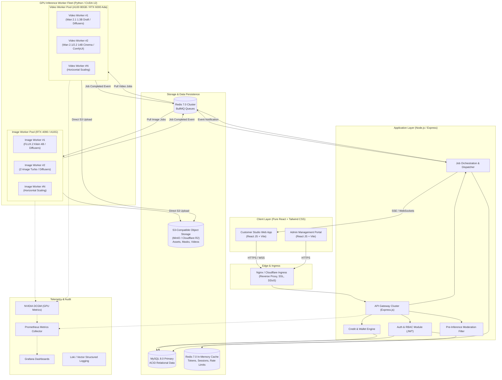
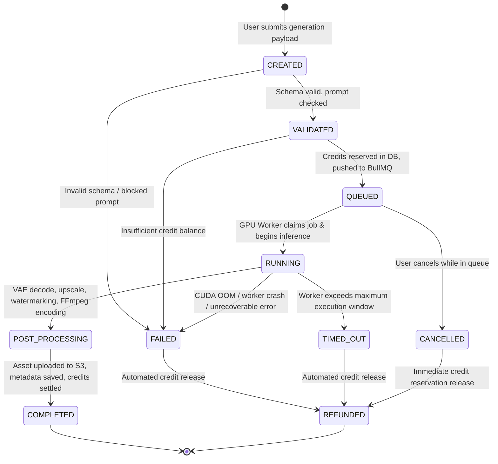

# System Architecture & Technical Design

**Document Version:** 1.0.0  
**Status:** Approved for Architecture & Planning (Phase 1)  
**Author:** Principal AI Systems & SaaS Architect  
**Target Environment:** Dockerized Multi-Node Cluster / Bare-Metal GPU Cloud  

---

## 1. Architectural Philosophy & High-Level Overview

The system is designed as an asynchronous, event-driven, decoupled microservices platform. The computationally intensive AI generation workloads are strictly decoupled from user-facing web requests via Redis and BullMQ. 

### Core Architectural Principles:
1. **Asynchronous Non-Blocking Execution:** User HTTP requests never block on GPU inference. Jobs are validated, ledger-reserved, and dispatched into distributed queues within milliseconds.
2. **Strict Worker Isolation:** Dedicated, independently scalable worker pools for Image and Video generation prevent heavy video jobs from starving fast, sub-second image jobs.
3. **Stateless Gateway & Stateful Queue:** The Express API gateways are completely stateless, enabling seamless horizontal auto-scaling behind load balancers.
4. **Idempotent Financial Ledger:** Credit operations (reservations, settlements, refunds) are isolated within strict ACID database transactions with row-level locks.
5. **Direct Storage Offloading:** Large binary media files (images, MP4 videos) never stream through Node.js API memory; uploads and downloads leverage secure, presigned S3 URLs directly between the client browser/worker and the object storage cluster.

---

## 2. End-to-End System Architecture Diagram



---

## 3. Subsystem Breakdown & Specifications

### 3.1 Customer & Admin Frontend Applications
- **Core Technology:** Pure React (JavaScript JSX), bundled with Vite. Strict adherence to prompt guidelines: **No Next.js, No TypeScript.**
- **Styling:** Tailwind CSS with an enterprise-grade dark/light mode palette optimized for visual asset editing.
- **State Management & Data Fetching:** React Context API + lightweight custom hooks with native `fetch` and EventSource (Server-Sent Events) for live job status updates.
- **Interactive Studio Canvas:** HTML5 Canvas integration for interactive inpainting mask drawing, rectangular bounding box conditioning, and side-by-side asset comparison.
- **Admin Portal Capabilities:**
  - Fleet telemetrics (online/busy/offline worker count, GPU memory utilization, device temperatures).
  - Queue depth and throughput gauges.
  - User management, credit manual grant/deduct, account suspension.
  - Model registry configuration and global kill-switches.

### 3.2 Backend API Gateway (Node.js / Express)
- **Framework:** Express.js running on Node.js 20 LTS.
- **Architectural Pattern:** Modular Layered Controller-Service-Repository pattern.
- **Key Middleware:**
  - `helmet`: Secure HTTP headers (CSP, HSTS, X-Frame-Options).
  - `cors`: Restricted cross-origin resource sharing.
  - `express-rate-limit` & `rate-limiter-flexible` backed by Redis for IP and user-level throttling.
  - `winston` + `morgan`: Structured JSON logging with correlation IDs (`x-request-id`).
- **Real-Time Notifications:** Server-Sent Events (SSE) endpoint `/api/v1/generate/jobs/:jobId/stream` allowing real-time stage progress reporting (`QUEUED`, `RUNNING`, `POST_PROCESSING`, `COMPLETED`).

### 3.3 Message Broker & Queue Orchestration (Redis + BullMQ)
BullMQ orchestrates distributed task delivery with the following queue partitions:

```
Queues:
├── queue:image:priority     (Subscribed users / High priority)
├── queue:image:standard     (Standard users)
├── queue:video:priority     (Subscribed users / High priority)
├── queue:video:standard     (Standard users)
└── queue:job:events         (Worker completion / progress events back to API)
```

- **Priority Scheduling:** Subscribers receive jobs marked with priority weights ($10 > 5 > 1$).
- **Delayed & Retry Strategies:** Failed jobs are automatically retried up to 2 times for transient network/VRAM failures with exponential backoff before being pushed to the Dead-Letter Queue (DLQ).
- **Concurrency Control:** Queue concurrency is bounded by the active registered worker count.

### 3.4 GPU Worker Fleet & Inference Architecture

#### Image Worker Pool
- **Runtime:** Python 3.11, PyTorch 2.4+, CUDA 12.4 in Docker container.
- **Inference Engine:** Hugging Face `diffusers` with PyTorch native optimizations (`torch.compile(mode="reduce-overhead")`, FlashAttention-2 / SageAttention, FP8 `e4m3fn` weights).
- **Primary Model:** `FLUX.2-klein-4B` loaded into GPU VRAM once at container startup (zero cold-start latency per job).
- **Secondary Model:** `Z-Image-Turbo` loaded in dedicated alternate workers or dynamic memory space.
- **Worker Execution Flow:**
  1. Worker continuously polls BullMQ via Redis.
  2. Pulls job payload (Prompt, Seed, Dimensions, Steps, Guidance Scale).
  3. Executes model inference on local GPU.
  4. Encodes result to WebP / PNG.
  5. Uploads asset directly to S3 storage via `boto3`.
  6. Emits `JOB_COMPLETED` event with S3 asset key and metadata to Redis event stream.

#### Video Worker Pool
- **Runtime:** Python 3.11, PyTorch 2.4+, CUDA 12.4.
- **Inference Engine:** Hugging Face `diffusers` and headless `ComfyUI` CLI execution wrapper for complex temporal nodes.
- **Primary Models:**
  - Fast Draft: `Wan2.1-T2V-1.3B` (480p).
  - High-Fidelity Cinema: `Wan2.1-T2V-14B` / `Wan2.1-I2V-14B-720P` (720p).
- **Optimization:** DeepSpeed / Block-by-Block offloading for 14B models on 24GB GPUs; full native BF16 execution on 48GB/80GB cards.
- **Video Post-Processing:** Automated FFmpeg H.264 / AAC compression and WebM streaming conversion prior to S3 upload.

### 3.5 Storage Layer & Download Delivery
- **Object Storage:** Self-hosted MinIO cluster (multi-tenant, multi-drive) for private on-premise deployments; Cloudflare R2 or AWS S3 for cloud deployments.
- **Zero-Egress Strategy:** If deployed on Cloudflare R2, asset download egress fees are $0.00.
- **Security:** Storage buckets are private. No public read access. Clients access assets via short-lived Presigned URLs (TTL: 15 minutes) or CDN edge tokens.

### 3.6 Model Registry & Weight Cache
- **Model Storage:** Model weights are stored on a high-speed shared NVMe network volume (`/models/weights/`) mounted read-only into GPU worker containers.
- **Versioning:** Models are tracked via explicit semantic versions and SHA-256 git commit hashes in the `model_registries` database table.
- **Warm Loading:** Container startup scripts verify weight integrity against local SHA-256 checksums before signaling `READY` to the orchestrator.

---

## 4. Job Lifecycle & State Machine



### State Definitions & Failure Handling:
1. **CREATED:** Generation request received by API gateway.
2. **VALIDATED:** Input parameters pass JSON schema validation and pre-inference moderation check.
3. **QUEUED:** Credit amount is reserved in `credit_wallets` table; job payload pushed to BullMQ queue.
4. **RUNNING:** GPU worker pulls job, transitions state, and updates heartbeat in Redis.
5. **POST_PROCESSING:** Raw latent tensor decoded via VAE; FFmpeg encodes MP4 video; thumbnail generated.
6. **COMPLETED:** Media uploaded to S3; asset record created in `generated_assets`; credit transaction settled (`SETTLE`).
7. **FAILED:** Any unhandled exception during processing. BullMQ retries once if transient. If permanent, status marked `FAILED` and credits are refunded (`REFUND`).
8. **CANCELLED:** If the user cancels before the job is claimed by a worker, the job is popped from BullMQ and reserved credits are unlocked.
9. **TIMED_OUT:** Monitored by a watchdog cron. If a job remains in `RUNNING` status without heartbeat for >300 seconds (images) or >900 seconds (videos), the worker is presumed dead, the job is marked `TIMED_OUT`, and credits are refunded.

---

## 5. Horizontal Scaling & High Availability Strategy

### 5.1 Gateway & API Auto-Scaling
- Express API nodes run in stateless Docker containers managed by Docker Swarm or Kubernetes.
- Horizontal scaling triggers when CPU utilization exceeds 70% or active HTTP connection count exceeds 500 per container.

### 5.2 GPU Worker Fleet Auto-Scaling
- Scaling metric: **Queue Waiting Time & Queue Depth**.
- **Scale-Up Rule:** If `queue:image:standard` depth $> 10$ jobs for $> 30$ seconds, trigger provisioning of additional on-demand GPU instances (via cloud provider APIs such as RunPod, Vast.ai, or Lambda Labs).
- **Scale-Down Rule:** If worker queue is empty for $> 10$ minutes, gracefully drain worker and terminate on-demand instance to eliminate idle GPU burn.
- **Warm Pool:** A minimum baseline of dedicated reserved GPUs (e.g., 2× RTX 4090 for images, 1× A100 for video) is maintained 24/7 to guarantee zero cold-start latency.

